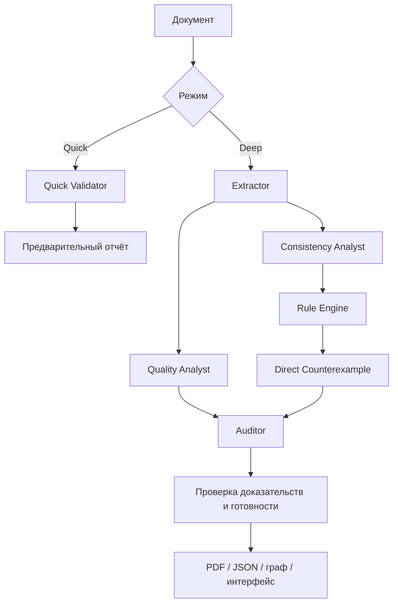

# REQUIRAGENTS 2.0

**AI-агент проверки технических требований для BCC-HUB × MNU FinTech Hackathon**

[](https://github.com/erv1y/hackathon_mnu_bcc/actions/workflows/test.yml)


REQUIRAGENTS помогает бизнес-аналитикам находить дефекты требований **до начала разработки и тестирования**: противоречия, неоднозначности, пропущенные условия, дублирование и непроверяемые формулировки. Агент связывает замечания с исходным документом, предлагает действия и формирует отчёт на русском языке.

[Быстрый запуск](#быстрый-запуск) · [CLI](#запуск-одной-командой-cli) · [Архитектура](#архитектура) · [Тестирование](#тестирование-и-наблюдения) · [Техническая документация](INTEGRATION.md)

## Два режима анализа

| | Quick | Deep |
|---|---|---|
| Назначение | Первичное ревью | Детальный аудит требований |
| AI-роли | Один агент | Extractor, Quality Analyst, Consistency Analyst, Auditor |
| Проверка отдельных требований и набора | Да | Да |
| Независимый аудит замечаний | Нет | Да, при полном завершении |
| Оценка готовности к разработке | Не присваивается | При достаточном покрытии |
| 3D-интерфейс | Квартира | Офис команды |

### Возможности

- PDF, DOCX, Markdown и TXT; до пяти документов в веб-интерфейсе.
- Реестр требований, исходные цитаты и координаты, проверка качества и согласованности.
- Проверка замечаний независимым Auditor, объединение дубликатов с сохранением истории.
- Интерактивный граф требований, журнал работы агентов, фильтры и приоритеты.
- Согласование спорных правил человеком, редактирование отдельного черновика без изменения оригинала, сравнение отчётов и локальный поиск ответов по источникам.
- Сценарии тестирования, экспорт CSV и Excel SpreadsheetML, PDF и JSON.
- Технический и Executive PDF, интерфейс RU / KK / EN.
- Сохранение валидных результатов при частичных сбоях, адресные повторы, fallback моделей Gemini и контрольные точки.
- Офлайн-демо с явно обозначенными сохранёнными результатами — без ключа и вызовов LLM.

## Быстрый запуск

Основная ветка — `main`. Основной интерфейс — **FastAPI**, порт 8000. Python 3.12, Git и браузер с WebGL для 3D-сцен. На Windows для PDF используется Arial; на Linux установите DejaVu Sans.

### 1. Установка

**Windows (Git Bash):**

```bash
git clone https://github.com/erv1y/hackathon_mnu_bcc.git
cd hackathon_mnu_bcc
py -3.12 -m venv .venv
.venv/Scripts/python.exe -m pip install -r requirements.txt
```

### 2. Офлайн-демонстрация (без API-ключа)

```bash
AUDIT_DEMO_ONLY=1 .venv/Scripts/python.exe -m uvicorn web:app --host 127.0.0.1 --port 8000
```

Откройте [http://127.0.0.1:8000/audit?demo=1](http://127.0.0.1:8000/audit?demo=1). Встроенный пример использует сохранённые результаты, а не новый прогон Gemini. Можно изучить доказательства, сравнение, черновики, сценарии и PDF. На [обычной странице проверки](http://127.0.0.1:8000/audit) доступны переключение режимов и сцены.

### 3. Реальная AI-проверка

Получите собственный ключ в [Google AI Studio](https://aistudio.google.com/apikey). В корне проекта создайте локальный `.env` из шаблона:

```bash
test -f .env || cp .env.example .env
notepad .env
```

Укажите свой `GEMINI_API_KEY`. Не публикуйте этот файл. `GEMINI_MODEL` задаёт настроенную модель; отдельные агенты могут использовать собственную модель и fallback. Фактические модели записываются в паспорт прогона.

Остановите сервер демо (Ctrl+C), затем:

```bash
unset AUDIT_DEMO_ONLY
.venv/Scripts/python.exe -m uvicorn web:app --host 127.0.0.1 --port 8000
```

Перейдите на [http://127.0.0.1:8000/audit](http://127.0.0.1:8000/audit), загрузите документ, выберите режим, подтвердите согласие на передачу текста в Gemini и запустите проверку. Для итогового отчёта предпочтителен Deep. Доступность модели зависит от ключа и квоты API.

<details>
<summary>PowerShell, Linux и Docker</summary>

**Windows PowerShell (из корня клона):**

```powershell
py -3.12 -m venv .venv
.\.venv\Scripts\python.exe -m pip install -r requirements.txt
$env:AUDIT_DEMO_ONLY = "1"
.\.venv\Scripts\python.exe -m uvicorn web:app --host 127.0.0.1 --port 8000
```

Для live-режима настройте `.env`, остановите сервер, выполните `Remove-Item Env:AUDIT_DEMO_ONLY -ErrorAction SilentlyContinue` и повторите запуск Uvicorn.

**Linux (из корня клона):**

```bash
python3.12 -m venv .venv
.venv/bin/python -m pip install -r requirements.txt
AUDIT_DEMO_ONLY=1 .venv/bin/python -m uvicorn web:app --host 127.0.0.1 --port 8000
```

**Docker (офлайн-демо):**

```bash
docker build -t requiragents .
docker run --rm -e AUDIT_DEMO_ONLY=1 -p 127.0.0.1:8000:8000 requiragents
```

При корпоративном TLS-прокси передайте доверенный CA через `docker build --secret id=pip_ca,src=/path/to/ca-bundle.pem -t requiragents .`.

</details>

## Запуск одной командой (CLI)

После установки зависимостей и настройки ключа, из корня проекта (Git Bash):

```bash
.venv/Scripts/python.exe main.py --input "path/to/requirements.pdf" --output "reports/audit.pdf" --mode deep
```

Замените путь на выданный организаторами файл. Для тестового прогона можно использовать `examples/01_refund_api.md`; для предварительного — `--mode quick`. Команда выполняет реальный запрос к LLM, не офлайн-воспроизведение.

- `--cache` включает локальные контрольные точки для повторного запуска с теми же входом и настройками.
- `--force` принудительно запускает новый анализ.
- Код выхода: 0 — выполнено, 2 — сохранён частичный Deep-отчёт, 1 — ошибка выполнения.

Исходный документ организаторов и сгенерированный отчёт сдаются отдельно от репозитория, согласно [официальному заданию](https://github.com/BCC-HUB/ai-requirements-validator-task).

## Архитектура



| Роль | Ответственность |
|---|---|
| Extractor | Выделение требований и проверка привязки к исходному тексту |
| Quality Analyst | Корректность, ясность, полнота, проверяемость и другие свойства отдельных требований |
| Consistency Analyst | Противоречия, дублирование, зависимости и согласованность набора |
| Auditor | Независимая проверка кандидатов, подтверждение, пересмотр, отклонение и обоснованное объединение |

Четыре агента — логические роли, а не четыре обязательно разные модели. Критерии опираются на постановку хакатона и свойства качественных требований ISO/IEC/IEEE 29148 и IEEE 830.

**Надёжность:** модель выбирает источники, а приложение формирует точные цитаты и координаты из проверенного реестра (Auditor и актуальная реализация Quick). Неизвестные ID, неполные пары и несогласованные решения отклоняются. При восстановлении валидные решения сохраняются; непроверенные остаются предварительными. Direct Counterexample проверяет ограниченный набор выбранных пар, а не все возможные логические состояния.

**Стек:** Python 3.12 · FastAPI · LangGraph · Gemini API · Pydantic · Three.js · HTML/CSS/JavaScript · SQLite · PyMuPDF · ReportLab · NetworkX.

## Содержание отчёта

- Паспорт прогона: документ, дата, фактически использованные модели, Git-ревизия (если доступна).
- Реестр требований с ID исходника и отчёта, формулировкой и доказательствами.
- Оценки отдельных требований и замечания по набору в целом.
- Приоритеты Critical / High / Medium / Low, рекомендации и история решений Auditor.
- Для полного Deep: `ready`, `conditionally_ready` или `not_ready`, с указанием ограничений.

Quality Score — средняя модельная оценка требований **до аудита**, не точность AI. Quick не присваивает готовность. Частичный Deep не выдаёт заключение о готовности. Подлинность цитаты не гарантирует правильность её смысловой интерпретации.

## Тестирование и наблюдения

Последние успешные реальные прогоны 27 ноября 2026 года на одном синтетическом `test.pdf`:

| Показатель | Quick | Deep |
|---|---:|---:|
| Время | 23,3 с | 175,8 с |
| Завершённые этапы | 1/1 | 4/4 |
| Извлечённые требования | 18 | 18 |
| Независимый аудит | Нет | Да |

Quick был примерно в 7,5 раза быстрее в этой паре наблюдений. Это не контролируемый бенчмарк и не оценка точности. Deep выполнен на ревизии `d6cbaec`, Quick — с исправлением, опубликованным в `f859896`. Результаты могут отличаться при новом запуске.

Исторический полный анализ спецификации BCC (26 ноября, прежняя версия): 49 извлечённых записей, 9 замечаний и кандидатов, 2 High, статус `not_ready`, 182,48 с без генерации PDF. См. [исторические заметки релиза](RELEASE_NOTES_v08.md). Эти результаты не следует выдавать за повторный прогон текущей версии.

**Офлайн-проверки, не расходующие Gemini:**

```bash
AUDIT_DEMO_ONLY=1 .venv/Scripts/python.exe -m unittest discover -s tests -v
node --test tests/test_auditor_frontend.cjs tests/test_product_frontend.cjs
AUDIT_DEMO_ONLY=1 .venv/Scripts/python.exe -m evaluate --check
AUDIT_DEMO_ONLY=1 .venv/Scripts/python.exe -m evaluate_quality
AUDIT_DEMO_ONLY=1 .venv/Scripts/python.exe -m evaluate_graph --check-data
```

Для JS-тестов нужен Node.js. Не запускайте произвольные исторические `test_*.py`: некоторые обращаются к API. В CI также выполняются автономные регрессионные сценарии и тест веб-интерфейса на Windows. [Результаты CI](https://github.com/erv1y/hackathon_mnu_bcc/actions). Наборы из 8 и 30 синтетических сценариев используются для диагностики, а не для заявления универсальной точности. Подробности — в [INTEGRATION.md](INTEGRATION.md).

## Структура репозитория

```text
agents/              # AI-роли и проверка ответов
core/                # Модели, правила, API-клиент, отчёты и граф
prompts/             # Системные инструкции
static/              # Интерфейс, Three.js, сцены и локализация
templates/           # HTML-страницы FastAPI
evaluation/          # Синтетические кейсы и сохранённое демо
examples/            # Публичные тестовые документы
tests/               # Регрессионные и интеграционные тесты
web.py               # FastAPI — основной интерфейс
web_engine.py        # Связь сайта и LangGraph
web_report.py        # Представление результатов на сайте
orchestrator.py      # LangGraph pipeline
main.py              # CLI
requirements.txt    # Зависимости
.env.example         # Шаблон без ключа
```

Исторический Streamlit-интерфейс и совместимые модули сохранены для воспроизводимости. Для работы с актуальной версией используйте FastAPI или CLI.

## Ограничения и конфиденциальность

- Для live-анализа текст отправляется в Gemini. Не передавайте конфиденциальные данные без разрешения.
- Не коммитьте `.env`, личные документы, `reports/`, локальные базы и резервные копии. При включении постоянного кэша данные хранятся в SQLite без шифрования.
- Ошибки квоты, тайм-ауты и невалидные ответы могут привести к частичному результату. Контрольные точки помогают продолжить проверку, но не гарантируют успех.
- Не все пары требований проверяются; программные правила ограничены поддерживаемыми шаблонами. Полнота и смысловая точность не гарантируются.
- Необоснованные финансовые решения не принимаются автоматически. В спорных случаях требуется согласование ответственным человеком.

---

**REQUIRAGENTS** · Проект студенческой команды MNU для BCC-HUB × MNU FinTech Hackathon.
