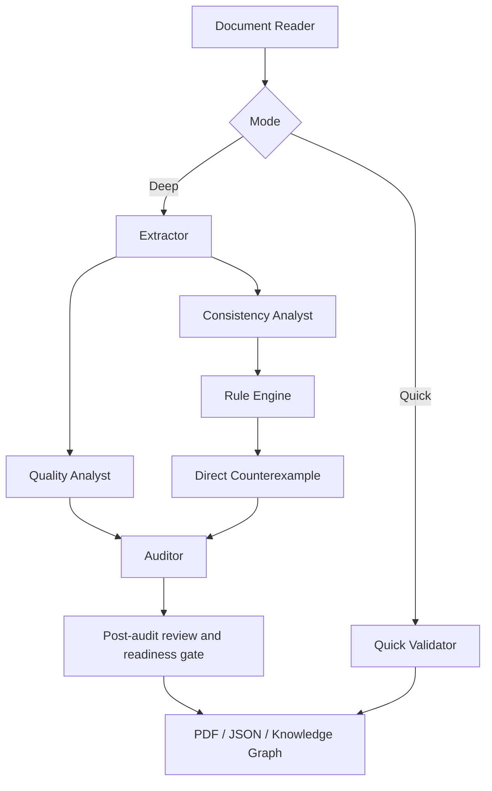

# ReqAgent

**BCC-HUB × MNU FinTech Hackathon · v0.8 Release Candidate**

Мультиагентный инструмент поддержки бизнес-аналитика: анализирует технические задания, выявляет потенциальные дефекты требований, сопоставляет их с исходным текстом и формирует отчёт о готовности к разработке.

## Возможности

- Загрузка PDF, DOCX, Markdown и TXT; в интерфейсе — от одного до пяти документов, включая междокументный анализ.
- Quick Mode: предварительный анализ без отдельного аудита.
- Deep Mode: четыре логических AI-агента, параллельный анализ качества и согласованности, дополнительные программные проверки, аудит и оценка готовности.
- Реестр требований с исходными цитатами, идентификаторами и координатами источника; проверка подлинности доказательств.
- Объединение потенциальных дубликатов с сохранением истории решений и цитат.
- Интерактивный граф требований и замечаний; экспорт PDF, JSON и графа JSON.
- Опциональные локальные SQLite checkpoints для возобновления и повторного использования анализа; fallback моделей Gemini при ошибках API.

## Архитектура



**Стек:** Python, Streamlit, LangGraph, Gemini API (`google-genai`), Pydantic, PyMuPDF, python-docx, ReportLab, NetworkX, PyVis, SQLite.

Четыре агента — логические роли, а не четыре разные модели. Direct Counterexample анализирует ограниченный набор выбранных пар. Старый символический модуль сохранён для экспериментов и используется для отбора пар, но символический solver не является обязательным этапом Deep Mode. Дополнительные REVIEW-кандидаты создаются ограниченными программными правилами после AI-аудита и требуют ручного подтверждения.

## Запуск с нуля (Windows 11, PowerShell)

Требования: Python 3.12, Git, доступ к Gemini API и API-ключ. Для PDF необходим доступный Unicode-шрифт (Arial в Windows; для дополнительного раздела PDF предусмотрен fallback DejaVu Sans в Linux). Полный запуск подтверждён в Windows; другие ОС отдельно не проверялись.

Клонируйте репозиторий через GitHub, откройте его корневую папку в терминале и выполните:

```powershell
py -3.12 -m venv .venv
Set-ExecutionPolicy -Scope Process -ExecutionPolicy Bypass
.\.venv\Scripts\Activate.ps1
python -m pip install -r requirements.txt
Copy-Item .env.example .env
notepad .env
```

Укажите собственный `GEMINI_API_KEY` в `.env`. Не публикуйте ключ. `GEMINI_MODEL` задаёт настроенную модель; агенты могут запрашивать другие модели согласно текущей конфигурации fallback. Доступность зависит от аккаунта, квот и API.

```powershell
python -m streamlit run app.py
```

Откройте локальный адрес, показанный в терминале (обычно `http://localhost:8501`). Загрузите документ, выберите режим, подтвердите разрешение на передачу текста в Gemini, при необходимости включите локальный кэш и запустите проверку.

## Демонстрация

Публичные синтетические примеры находятся в `examples/`. Они не содержат исходных материалов BCC или клиентских данных.

**Один документ через CLI:**

```powershell
python main.py --input examples/01_refund_api.md --output reports/demo_refund.pdf --mode deep
```

Для предварительной проверки замените `--mode deep` на `--mode quick`. Параметр `--cache` разрешает локальное сохранение checkpoints; без него постоянный кэш не используется. CLI передаёт текст внешнему API: запускайте его только для документов, на обработку которых есть разрешение.

**Междокументная демонстрация:** загрузите оба файла из `examples/` в Streamlit, выберите Deep Mode. В примерах специально задана операция записи через GET и несовместимые нижние границы возврата (1 и 500 ₸). Это контрольные вопросы для проверки вручную, а не гарантированный результат AI. Новые примеры ещё не прогонялись через реальный API.

После анализа откройте Findings, Requirements, Knowledge Graph, Audit Trail и Methodology. Скачайте PDF и JSON. Не включайте публично реальные клиентские данные.

## Что содержит отчёт

- Итоговый статус: `ready`, `conditionally_ready` или `not_ready`.
- Серьёзность замечаний: Critical, High, Medium, Low; объяснение, рекомендация и исходные цитаты.
- Реестр требований, журнал аудита, матрица трассируемости и паспорт прогона: документы, время, фактически использованные модели, Git-ревизия (при наличии).

Quality Score — оценка требований до аудита, а не точность обнаружения дефектов. Статус готовности определяется результатами анализа и консервативной политикой readiness gate; это не сертификация требований. При наличии High/Critical замечаний Deep Mode не присваивает статус `ready`. REVIEW-кандидаты должны быть проверены человеком.

## Проверенные результаты

26 ноября 2026 года успешно выполнен полный Deep-анализ исходной спецификации BCC через локальный Streamlit-интерфейс:

| Показатель | Наблюдение |
| --- | ---: |
| Извлечённые записи | 49 |
| Итоговые замечания и кандидаты | 9 |
| Critical / High / Medium / Low | 0 / 2 / 6 / 1 |
| Средний Quality Score до аудита | 94,3 / 100 |
| Время анализа (без генерации PDF) | 182,48 с |
| PDF | 29 страниц |
| Статус | not_ready |

В итоговом отчёте появились два ранее пропущенных случая: разные месяцы учёта одной покупки и неоднозначность приоритета месячного лимита уведомлений при смене порога. Это программные кандидаты, а не независимое подтверждение всех дефектов. Некоторые итоговые замечания остаются спорными или дублирующимися. Это регрессионная проверка на знакомом документе, не измерение Precision/Recall на независимом наборе. Время и число замечаний могут меняться при новых запусках.

Локальные проверки, которые успешно выполнялись на компьютере разработчика:

```powershell
python test_auditor_v08.py
python test_counterexample_v08.py
python test_release_review.py
```

Эти тесты используют синтетические фикстуры и/или имитацию API. Другие `test_*.py` могут быть историческими или обращаться к API; не запускайте все подряд без проверки. `release_check.py` — исторический offline replay, требует локальных отчётов и исходного `docs/requirements.md`, поэтому на чистом клоне не является командой smoke test. Подробности в [RELEASE_NOTES_v08.md](RELEASE_NOTES_v08.md).

## Структура

```text
agents/                 # Извлечение, анализ качества, согласованности, аудит, Quick
core/                   # Модели, чтение, проверки, граф, отчёты, API-клиент
prompts/                # Системные инструкции агентов
examples/               # Публичные синтетические примеры
app.py                  # Streamlit
main.py                 # CLI для одного документа
orchestrator.py         # LangGraph pipeline
release_check.py        # Историческая локальная перепроверка
requirements.txt        # Зависимости
.env.example            # Шаблон настроек без секретов
```

## Конфиденциальность и ограничения

- Анализ требует передачи исходного текста в Gemini API; не используйте конфиденциальные документы без разрешения. При включённом кэше локальная база не шифруется.
- Не добавляйте `.env`, `.venv/`, личные документы, `reports/`, `.validator_cache/`, резервные копии и базы данных в Git. Публичные примеры должны оставаться синтетическими.
- Подлинность цитаты не гарантирует её смысловую релевантность. Полнота извлечения и обнаружения противоречий не гарантируется. Дедупликация может оставить повторы или объединить разные замечания.
- Парный анализ ограничен эвристическим отбором; программные правила после аудита охватывают узкие шаблоны русскоязычных требований. Не заявляется универсальное обнаружение бизнес-противоречий.
- Gemini может возвращать ошибочные или неполные результаты, а API — ошибки квоты и доступности. Fallback снижает риск прерывания, но не гарантирует успех.
- Независимые показатели Precision, Recall и F1 пока не установлены. Инструмент предназначен для поддержки, а не замены бизнес-аналитика.
